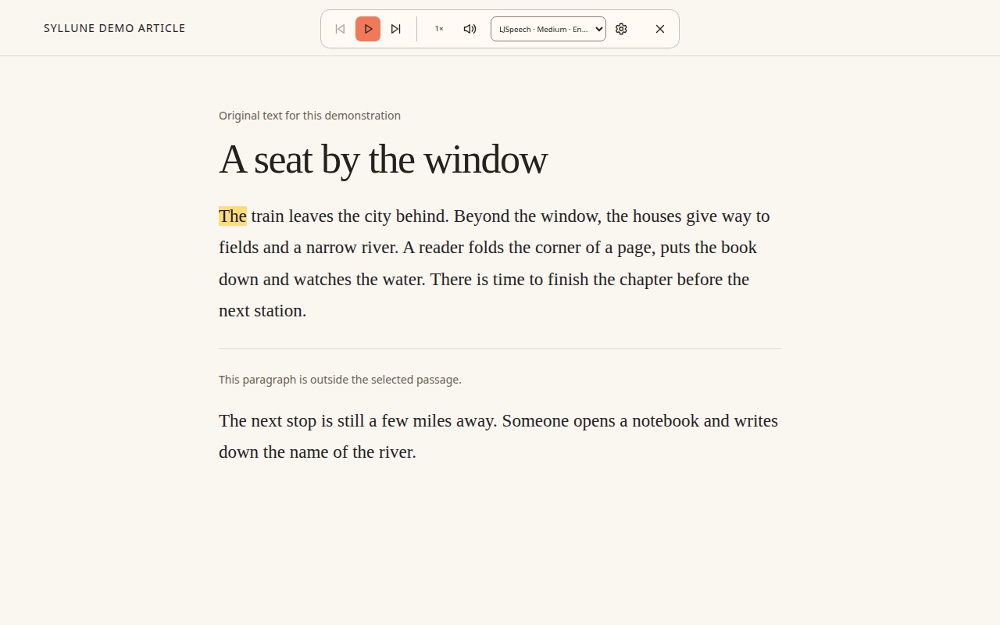

# Syllune

## Natural-sounding voices. On your computer.

Syllune reads articles, selected text and PDFs with natural-sounding voices in Chrome and Firefox. Download a voice once, then listen offline on your computer. Your reading text and synthesized audio never go to a speech service. No account, subscription or companion app.

Select a passage, right-click and choose **Read selection**. Syllune reads only that passage. Follow the word highlighting, pause when you need to, or move to the next sentence. Speed, volume and voice choice stay together in one compact playback bar. PDFs open in a separate reader tab without replacing the original.



Hear the voice before you download it. Press a voice's **play icon** for a prerecorded sample made with the same voice model and local speech engine used for reading. English and Czech are available alongside the wider multilingual catalog. Samples stream only on that action. Downloaded voices stay on your computer until you delete them. Voice quality and startup time depend on the model and your device.

Online documents and streamed samples still need a connection. Speech works offline after you install a voice and its required assets, with the source text available locally. See the [privacy policy](PRIVACY.md) for network and storage details.

## Try Syllune

The public brand was previously Read Aloud. This is the same project, with the same extension IDs and update path. The repository and release archives retain their `read-aloud` names.

Use a [tagged release](https://github.com/Fidasek009/read-aloud/releases) or build below. Chrome accepts the unpacked `.output/chrome-mv3/` folder in developer mode. Firefox users need an AMO-signed installation for normal use; `about:debugging` accepts a temporary development build. Store publication and product acceptance are separate from a successful build. No store installation links are claimed here until their public availability is verified.

See [known issues](docs/known-issues.md) before using the extension. [Acceptance status](docs/feasibility-status.md) records the remaining listening, Windows, physical GPU and accessibility checks. [The product brief](docs/product-brief.md) records the agreed behavior.

## Development

Use **Bun 1.4.4 or newer**. The runtime, dependency management, tests, type checks, formatter, and tooling all use Bun. WXT's framework build runs under Bun.

```sh
bun install --frozen-lockfile
bun run typecheck
bun run test
bun run format:check
bun run build
bun run build:firefox
```

For development, use `bun run dev` or `bun run dev:firefox`. Generated browser packages go in `.output/`. `bun run format` applies the preferences in [bunfig.toml](bunfig.toml).

Bun is development tooling; the finished extension must not require users to install Bun or a companion application. Model downloads must be deliberate user actions, never a side effect of opening or installing the extension.

## Technical notes

Model management and [original preview production](voice-previews/README.md) derive from the same complete catalog across every language and quality variant. Preview recordings are hosted separately and fetched only when you press a voice's play icon. Refresh pinned upstream catalog metadata with `bun run catalog:update`; it downloads no model weights.

The extension uses a Piper-based speech implementation. [Research](docs/research.md) and [engineering guidance](docs/engineering.md) describe the chosen approach and outstanding gates.

## License

Original project code is [MIT](LICENSE). Third-party runtime files, model weights, and voice/preview assets retain their own licenses. The extension bundles GPL-3.0-or-later Spellophone/eSpeak NG with MIT ONNX Runtime. Original source files remain MIT; the combined bundle has GPL distribution obligations. See [NOTICE.md](NOTICE.md) and the [licensing checklist and open model/preview questions](docs/licensing.md). Run `bun run check:licenses` to verify supplied license/source materials; passing it does not establish release readiness.

## Browser checks

After building, use `bun run probe:chrome` and `bun run probe:firefox` for isolated product probes. They deliberately download a voice and delete it again. A working audio output is required; the Linux VM uses a private test sink via `bun scripts/with-test-audio.ts scripts/probe-product-firefox.ts`. The helper expects extracted Ubuntu PulseAudio test binaries under `.cache/test-audio/pulse/`; it installs no system service and is never part of the extension.

`bun run probe:pdf` requires the deliberately fetched thesis bytes in `.cache/benchmarks/muni-thesis.pdf`. Its evidence covers PDF rendering/text mapping, not full speech acceptance. See [current status](docs/feasibility-status.md) for exact limits.

## Voice management

The voice page exposes the full pinned catalog with search, source terms, variants, and explicit downloads. Candidates that require unsupported pronunciation engines are excluded from new downloads; older downloaded copies remain deletable. Playback controls and voice actions use icons with accessible names and tooltips. The bar's gear opens voice management, and right-clicking the browser extension action exposes its Options page.

## PDF checks

For a live PDF fetch check, use `PDF_SOURCE_URL=https://is.muni.cz/th/wdhgd/bc.pdf bun run probe:pdf`. The test checks access recovery in a fresh ungranted profile, then uses a narrow grant in a separate test copy; it does not click the browser's native permission dialog. In your normal browser, the new PDF tab may ask for access to the PDF's site. This is optional site access, not an install-time all-sites grant.

## Local diagnostics

Local timing/backend diagnostics are available from the extension page's developer console with `await browser.storage.local.get("lastSpeechPerformance")` (use `chrome` in Chrome). They contain no reading text. Cold initialization is still over the acceptance budget; do not interpret one VM run as a benchmark.

## CI and publishing

A pushed stable `vX.Y.Z` tag sets the version for both browser manifests and all archives, runs CI, submits those exact packages to Chrome Web Store and Firefox AMO for automatic publication after approval, then automatically publishes the GitHub release. No package-version bump or manual GitHub release step is required. Releases also attach an agent-created store package containing original artwork, real screenshots, listing/privacy copy and icon source. Store accounts/credentials and existing license/product acceptance work must be completed before real publication. See [release engineering](docs/releasing.md), [store package](store/listing.md), [privacy policy](PRIVACY.md), and [reviewer build instructions](SOURCE_CODE_REVIEW.md).
